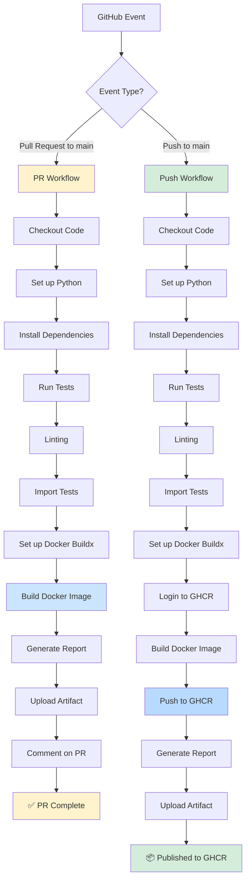

# 🔄 GitHub Actions Workflow Diagram

## Docker Build and Publish Workflow



---

## Workflow Behavior

### 1️⃣ Pull Request to `main`

```
Trigger: PR opened/updated targeting main branch

Steps:
1. ✅ Checkout code
2. ✅ Run tests (linting, imports)
3. ✅ Build Docker image
4. ⏭️ Skip publish (test only)
5. 💬 Comment on PR with build status

Result: Validates that code builds successfully
```

### 2️⃣ Push to `main`

```
Trigger: Commit pushed to main branch

Steps:
1. ✅ Checkout code
2. ✅ Run tests (linting, imports)
3. ✅ Build Docker image
4. 📦 Login to GHCR
5. 🚀 Push image to registry
6. 🏷️ Tag as 'latest', 'main', SHA

Result: New image available at ghcr.io/jackstealer/deepsea-edna:latest
```

---

## Test Pipeline

```
┌─────────────────────────────────────────┐
│          Test Suite                     │
├─────────────────────────────────────────┤
│  1. Install Dependencies                │
│     • pip install test requirements     │
│     • pip install app requirements      │
│                                         │
│  2. Code Quality (flake8)               │
│     • Check syntax errors               │
│     • Check complexity                  │
│                                         │
│  3. Import Validation                   │
│     • Test core imports                 │
│     • Test API imports                  │
│                                         │
│  4. Test Summary                        │
│     • Report results                    │
└─────────────────────────────────────────┘
```

---

## Docker Build Pipeline

```
┌─────────────────────────────────────────┐
│      Docker Build Process               │
├─────────────────────────────────────────┤
│  1. Set up Docker Buildx                │
│     • Multi-platform support            │
│     • Build cache enabled               │
│                                         │
│  2. Extract Metadata                    │
│     • Generate tags                     │
│     • Add labels                        │
│                                         │
│  3. Build Image                         │
│     • Use Dockerfile                    │
│     • Platform: linux/amd64             │
│     • Cache layers                      │
│                                         │
│  4. Conditional Push                    │
│     • PR: Build only                    │
│     • Main: Build + Push                │
└─────────────────────────────────────────┘
```

---

## Publishing Pipeline (Main Only)

```
┌─────────────────────────────────────────┐
│     GHCR Publishing Process             │
├─────────────────────────────────────────┤
│  1. Authenticate to GHCR                │
│     • Registry: ghcr.io                 │
│     • Auth: GITHUB_TOKEN                │
│                                         │
│  2. Push Docker Image                   │
│     • Repository: jackstealer/deepsea-edna │
│     • Tags: latest, main, SHA           │
│                                         │
│  3. Update Package Metadata             │
│     • Labels from git                   │
│     • Links to source                   │
│                                         │
│  4. Make Publicly Accessible            │
│     • Available for docker pull         │
└─────────────────────────────────────────┘
```

---

## Tags Generated

### For Pull Requests
- `pr-123` - PR number tag
- `pr-123-abc1234` - PR + commit SHA

### For Push to Main
- `latest` - Always points to latest main
- `main` - Tracks main branch
- `main-abc1234` - Main + commit SHA
- `abc1234` - Short commit SHA

### For Tagged Releases
- `v1.0.0` - Semantic version
- `v1.0` - Major.minor version
- `v1` - Major version only

---

## Reporting

### Pull Request Comments

When a PR is created/updated, the workflow automatically comments:

```markdown
# 🐳 Docker Build Report

## Event Information
- **Event Type**: pull_request
- **Branch**: feature/new-feature
- **Commit SHA**: `abc1234...`

## ✅ Pull Request - Test Build

**Status**: Image built successfully (not published)
- Tests: ✅ Passed
- Build: ✅ Passed
- Publish: ⏭️ Skipped (PR only)

> 💡 Image will be published when PR is merged to main
```

### Push to Main Report

```markdown
# 🐳 Docker Build Report

## 🚀 Push to Main - Published

**Status**: Image built and published to GHCR
- Tests: ✅ Passed
- Build: ✅ Passed
- Publish: ✅ Published

## 📦 Published Image

### Pull Command
```bash
docker pull ghcr.io/jackstealer/deepsea-edna:latest
```

### Quick Run
```bash
docker run -d -p 8000:8000 ghcr.io/jackstealer/deepsea-edna:latest
```
```

---

## Permissions Required

The workflow needs these permissions:

```yaml
permissions:
  contents: read        # Read repository code
  packages: write       # Push to GHCR
  pull-requests: write  # Comment on PRs
```

These are automatically granted by GitHub Actions.

---

## Environment Variables

```yaml
env:
  REGISTRY: ghcr.io
  IMAGE_NAME: ${{ github.repository }}  # jackstealer/deepsea-edna
```

---

## Cache Strategy

```
Build Cache: GitHub Actions Cache
- Type: gha (GitHub Actions cache)
- Mode: max (cache everything possible)
- Benefit: Faster subsequent builds
```

---

## Timeline Example

### Pull Request Flow (5-7 minutes)

```
00:00 - PR opened/updated
00:01 - Workflow triggered
00:02 - Tests running
00:03 - Docker build starts
00:06 - Build completes
00:07 - Comment posted on PR
        ✅ Ready for review
```

### Push to Main Flow (7-10 minutes)

```
00:00 - Code pushed to main
00:01 - Workflow triggered
00:02 - Tests running
00:03 - Docker build starts
00:06 - Build completes
00:07 - Login to GHCR
00:08 - Push image layers
00:10 - Image published
        📦 Available for pull
```

---

## Monitoring

### View Workflow Status

1. **Actions Tab**: https://github.com/jackstealer/DeepSea-eDNA/actions
2. **Workflow Runs**: Click any run to see details
3. **Build Logs**: Expand steps to see output

### Check Package

1. **Packages Tab**: https://github.com/jackstealer?tab=packages
2. **Package Page**: https://github.com/jackstealer/DeepSea-eDNA/pkgs/container/deepsea-edna
3. **Pull Stats**: View download counts

---

## Troubleshooting

### Build Fails on PR

```bash
# Check the workflow logs
# Fix the issue
# Push to PR branch
git add .
git commit -m "Fix build issue"
git push origin feature-branch
# Workflow re-runs automatically
```

### Build Fails on Main

```bash
# Check workflow logs
# Fix locally
git add .
git commit -m "Fix main build"
git push origin main
# Workflow re-runs
```

### Can't Pull Image

```bash
# Wait for build to complete (check Actions tab)
# Verify package is public
# Try pulling:
docker pull ghcr.io/jackstealer/deepsea-edna:latest
```

---

**Last Updated**: 2026-11-08
**Workflow File**: `.github/workflows/docker-build.yml`
**Status**: ✅ Active
